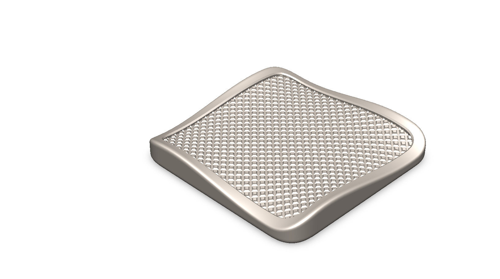
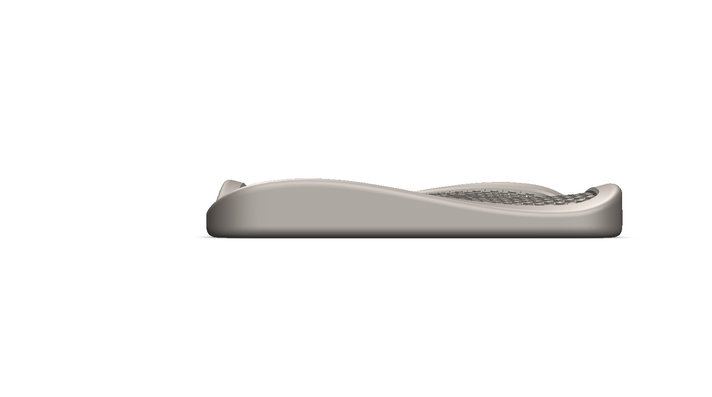
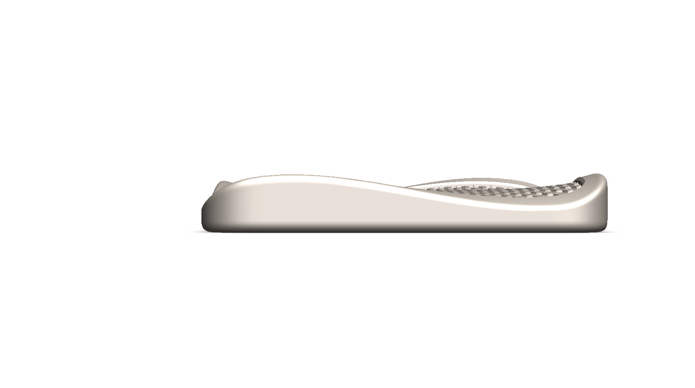
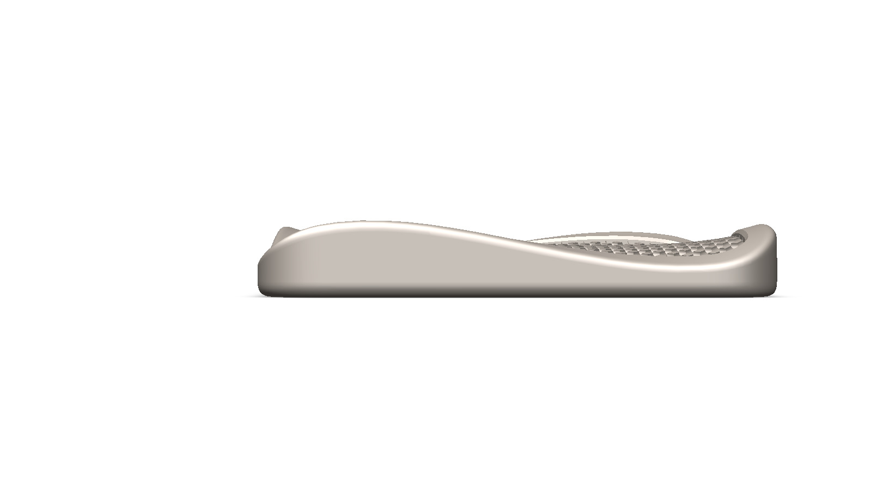
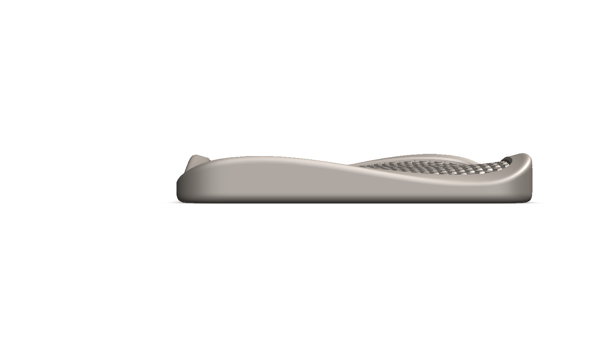
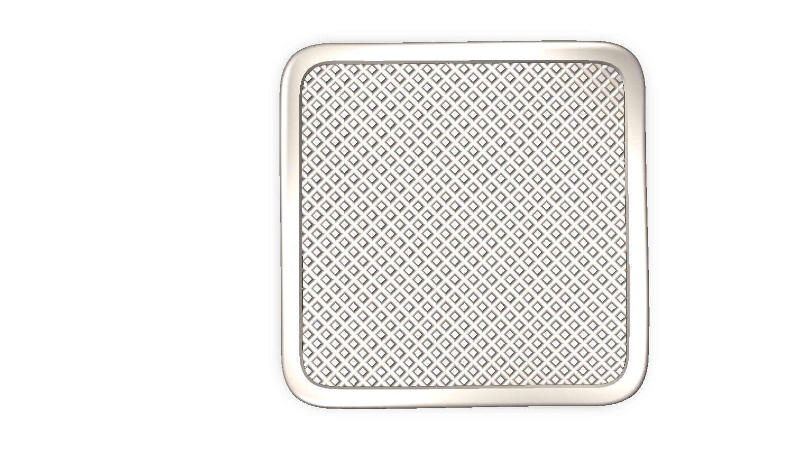
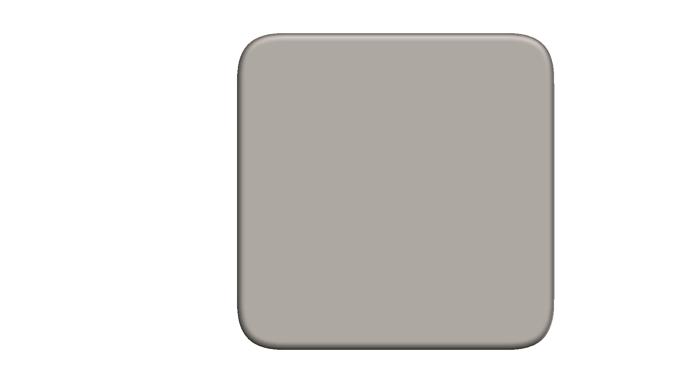
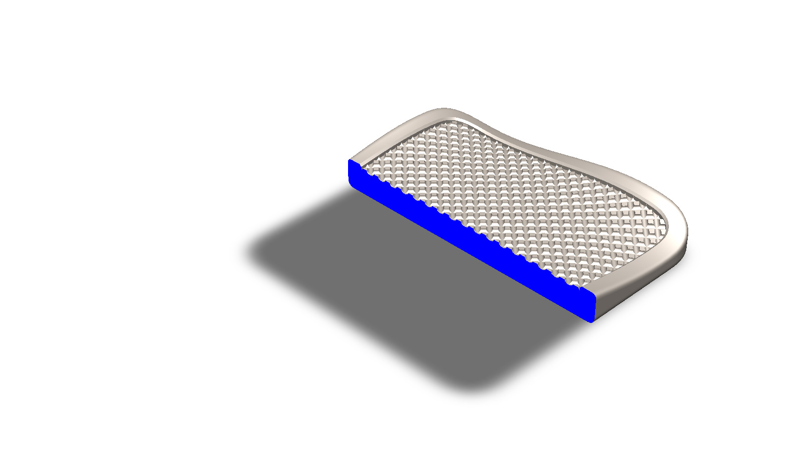
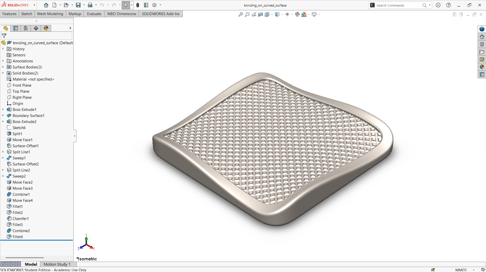

# A Wavy-Rimmed Pad with a Knurled Lattice on a Curved Surface

## Summary

Knurling is a surface pattern of fine, regularly spaced ridges that is pressed or cut into a part to improve grip. It is most familiar on lathe-turned handles and knobs, where the pattern is created on a simple cylinder. This project explores a different question: how a knurled pattern can be created on a surface that is curved rather than perfectly round or flat.

The model is a pad with a smooth, wavy outer rim that rises and falls along its edge. Inside the rim, a fine lattice of small raised diamonds covers the surface and follows the curvature of the pad, so the texture stays evenly spaced even where the surface bends. The rim frames the knurled area and gives the part a clean, finished edge. The main challenge was to keep the pattern consistent and continuous across the curved surface, because a pattern that is drawn on a flat sketch tends to stretch or distort when it is wrapped onto a curve.

The pad was developed as a computational model in SolidWorks. The views below show the lattice and the rim from every side, along with a section view of the part. This prototype is a base concept design that can be developed further into a real grip surface.

---

## Computational Design

|   View    |                                  Image                                  |
| :-------: | :---------------------------------------------------------------------: |
| Isometric |  |
|   Left    |            |
|   Right   |          |
|   Back    |            |
|   Front   |          |
|    Top    |              |
|  Bottom   |        |
|  Section  |      |

---

## Software Used

| Purpose |               Name                |
| :-----: | :-------------------------------: |
| Design  | SolidWorks 2024 (Student Version) |

---

## Feature Tree

| No  |       Name       |
| :-: | :--------------: |
| 01  |   Boss Extrude   |
| 02  | Boundary Surface |
| 03  |      Sketch      |
| 04  |      Split       |
| 05  |    Move Face     |
| 06  |  Surface Offset  |
| 07  |    Split Line    |
| 08  |      Sweep       |
| 09  |     Combine      |
| 10  |      Fillet      |
| 11  |     Chamfer      |

---

## Feature Tree Image

---

## Applications [^1][^2]

- Tool Handles
- Control Knobs and Adjustment Dials
- Fasteners and Screw Heads
- Automotive Shift Knobs and Steering Grips
- Surgical and Dental Instrument Handles
- Decorative Surface Finishes on Consumer Products

---

## Design Limitations

The design of the knurled surface was developed as a modeling exercise rather than a manufacturing-ready part. That’s why the real-life design considerations, including knurl pitch standards, material hardness, the diameter growth caused by the knurling process, grip testing, and feasibility on a lathe, have not been included.

---

## Future Improvements

The knurl was created as a modeled surface feature on a curved body, which makes the file heavy and slow to rebuild. In future work, the pattern should be driven by parameters such as pitch, depth, and angle, so that straight and diamond knurls can be switched on the same surface. Checking real manufacturability against the lathe knurling process, including material hardness and the resulting diameter increase, would make the model more realistic. A grip comparison between different patterns could also be done through simulation or physical testing.

---

## Acknowledgements

Special thanks to the [EasyCAD Solutions](https://www.youtube.com/@EasyCADSolutions) YouTube channel for the SolidWorks tutorials that helped in creating this design. I would also like to thank the [CAD CAM Tutorials](https://www.youtube.com/c/CADCAMTutorials) YouTube channel for its tutorials and learning resources, and [Mr. Md. Abdus Salam](https://mpe.iutoic-dhaka.edu/profile/salam/education), Drafting Instructor, Department of Mechanical and Production Engineering, Islamic University of Technology, for his guidance and support, and for his assistance in our ME 4210 3D Solid Modeling and Assembling lab course.

---

## References

[^1]: [Knurling: Process, Types, and Applications](https://www.xometry.com/resources/machining/knurling)

[^2]: [What is Knurling?](https://us.misumi-ec.com/blog/what-is-knurling/)
